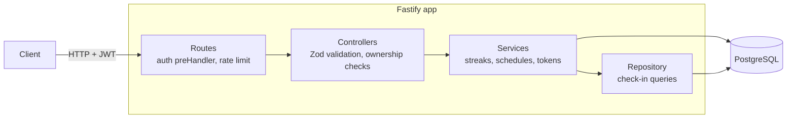

# LOOP API

A REST API for a habit tracker: JWT auth with role-based access, habits with
versioned schedules, check-ins, and streaks computed in each user's own
timezone. A portfolio project built and maintained like production software:
tested against a real database, gated by CI, deployed, and documented.

[](https://github.com/IgorCGouveia/LOOP-API/actions/workflows/ci.yml)
[](./LICENSE)
[](./docs/openapi.yaml)


| | |
|---|---|
| **Live API** | https://loop-api-jade.vercel.app |
| **Interactive docs (Swagger UI)** | https://loop-api-jade.vercel.app/docs |
| **OpenAPI spec** | [`docs/openapi.yaml`](./docs/openapi.yaml) |

<p align="center">
  <a href="#english"></a>
  <a href="#português"></a>
</p>

---

## English

- [What it does](#what-it-does)
- [Engineering highlights](#engineering-highlights)
- [Tech stack](#tech-stack)
- [Architecture](#architecture)
- [API documentation](#api-documentation)
- [Running locally](#running-locally)
- [Environment variables](#environment-variables)
- [Tests](#tests)
- [Deployment](#deployment)
- [Further documentation](#further-documentation)

### What it does

LOOP has no frontend. The HTTP contract is the product. A user signs up with
their IANA timezone, logs in, and creates habits with a schedule: every day,
specific weekdays, or every N days, with a target number of check-ins per day.
Each check-in returns the updated current streak, the longest streak, and
today's progress. Missing a single day can be covered by a "streak freeze"
token that refills once a month. Users only see and change their own data;
admins can manage everyone's.

### Engineering highlights

- **Ownership is checked against the database.** The API looks up who owns a
  habit before acting on it and never trusts an ID from the request body.
  This closes the classic IDOR hole.
- **Versioned schedules.** Editing a habit's frequency or target closes the
  current schedule version and opens a new one (a slowly changing dimension).
  Days that already ended keep the verdict they had.
- **Timezone-aware streaks with no background jobs.** The user's calendar day
  is frozen at write time. A day "closes" the moment it stops being today in
  the user's timezone, so there is no cron to run or fail.
- **Brute-force defense without account lockout.** After repeated failures for
  the same email, login responses are delayed (1s, 2s, then 5s) instead of
  blocked, since a lockout is itself a denial-of-service vector. The delay
  also applies to a correct password, so response time doesn't reveal it.
  Concurrent attempts per email are capped and the tracker's memory is
  bounded, so the defense can't be turned into an attack.
- **Fails fast on bad config.** The server refuses to boot with a missing,
  short, or placeholder `SECRET_KEY`.
- **One error shape everywhere.** Every error body has an `error` field.
  Unexpected errors never leak internals and return a `reqId` that points to
  the server log.
- **Documentation that can't silently drift.** The OpenAPI spec is checked in
  CI: a test fails if a route exists without docs or docs describe a route
  that doesn't exist.

### Tech stack

| Layer | Tool |
|---|---|
| Language | TypeScript (strict) |
| Runtime | Node.js 24 |
| HTTP framework | Fastify 5 |
| Database / ORM | PostgreSQL + Prisma 6 (versioned migrations) |
| Validation | Zod 4 (schemas also generate the TypeScript types) |
| Auth | JWT access token (1h) + httpOnly refresh cookie (7d), Argon2id password hashing |
| Rate limiting | `@fastify/rate-limit` per IP + a custom per-account delay tracker |
| API docs | OpenAPI 3 spec served at `/docs/json` + Swagger UI at `/docs` |
| Tests | Vitest, integration tests through `app.inject()` against a real Postgres |
| CI | GitHub Actions: Postgres service, type check, migrations, test suite |
| Hosting | Vercel (serverless Function) + Neon (serverless PostgreSQL) |

### Architecture

Layered, with each layer depending only on the one below it.



```
src/
├── routes/         # URL → controller, auth and rate-limit config per route
├── controllers/    # parse input, check permissions, shape the response
├── services/       # business rules: streaks, grace tokens, schedules, auth
├── repositories/   # check-in and schedule queries
├── schema/         # Zod schemas (request validation + inferred types)
├── Middleware/     # JWT auth, CORS, rate limit, central error handler
├── config/         # SECRET_KEY guard, refresh cookie options
├── utils/          # date/timezone helpers, token helpers
├── docs.ts         # serves docs/openapi.yaml at /docs
├── app.ts          # buildApp(): plugin and route registration
└── server.ts       # local / long-running entry: validate config, listen
api/index.ts        # Vercel Function entry: same app, no listen()
scripts/            # vercel-migrate.mjs (migrations during the Vercel build)
vercel.json         # build command, rewrites, Function config
prisma/             # schema.prisma + migrations
docs/openapi.yaml   # OpenAPI 3 spec
doc-2/              # architecture, ADRs, investigations (Portuguese)
```

### API documentation

Open **`/docs`** on a running server for Swagger UI, or **`/docs/json`** for
the raw spec. To try the protected routes in Swagger UI:

1. `POST /users` to create an account.
2. `POST /login` and copy `data.accessToken` from the response.
3. Click **Authorize**, paste the token, and call any route.

| Method | Route | Access | Description |
|---|---|---|---|
| POST | `/users` | public | Sign up (5/hour per IP) |
| POST | `/login` | public | Get an access token (IP + per-account limits) |
| POST | `/refresh` | refresh cookie | New access token (web client) |
| POST | `/logout` | public | Revoke the refresh cookie |
| GET | `/users` | admin | List users |
| PATCH | `/users/:id` | owner | Partial update; `timezone` cannot change |
| DELETE | `/users/:id` | owner or admin | Delete account |
| POST | `/habits` | user | Create a habit |
| GET | `/me/habits` | user | List my habits |
| GET | `/users/:userId/habits` | owner or admin | List a user's habits |
| GET | `/habits` | admin | List all habits |
| PATCH | `/habits/:id` | owner | Update; `schedule` must be sent whole |
| DELETE | `/habits/:id` | owner | Delete a habit |
| POST | `/habits/:habitId/checkin` | owner or admin | Check in today |
| DELETE | `/habits/:habitId/checkin` | owner or admin | Undo the last check-in |
| GET | `/habits/:habitId/checkins` | owner or admin | List a habit's check-ins |
| GET | `/users/:userId/checkins` | owner or admin | List a user's check-ins |

Example:

```bash
curl -X POST http://localhost:3333/login \
  -H "Content-Type: application/json" \
  -d '{"email":"ana@example.com","password":"senha12345"}'
```

```json
{
  "message": "Login realizado com sucesso.",
  "data": { "accessToken": "eyJhbGci...", "expiresIn": "1 hora", "id": "tz4a98...", "name": "Ana Silva", "role": "USER" }
}
```

Notes for building a client (CORS, refresh flow, token storage) are in
[`docs/API-REFERENCE.md`](./docs/API-REFERENCE.md) (Portuguese).

### Running locally

**Requirements:** Node.js 24 and PostgreSQL 14+. Docker is the quickest way to
get Postgres.

```bash
git clone https://github.com/IgorCGouveia/LOOP-API.git
cd LOOP-API

# 1. Start Postgres (skip if you already have one)
docker run -d --name loop-db -p 5432:5432 \
  -e POSTGRES_USER=loop -e POSTGRES_PASSWORD=loop -e POSTGRES_DB=loop \
  postgres:16

# 2. Configure the environment
cp .env.example .env
# set SECRET_KEY in .env, e.g. with: openssl rand -base64 48

# 3. Install, generate the Prisma client, apply migrations
npm ci
npx prisma generate
npx prisma migrate deploy

# 4. Run with hot reload
npm run dev
```

The API is now on http://localhost:3333 and the docs on
http://localhost:3333/docs.

| Script | What it does |
|---|---|
| `npm run dev` | Runs `src/server.ts` with `tsx watch` (no build step) |
| `npm test` | Runs the Vitest suite once (see [Tests](#tests)) |
| `npm run test:db:up` / `test:db:down` | Starts / drops the disposable test Postgres |
| `npm run build` | Generates the Prisma client and compiles to `dist/` |
| `npm start` | Applies pending migrations, then runs `dist/server.js` |

### Environment variables

See [`.env.example`](./.env.example).

| Variable | Required | Default | Description |
|---|---|---|---|
| `DATABASE_URL` | yes | | PostgreSQL connection string. Prisma CLI commands also need it. |
| `SECRET_KEY` | yes | | JWT signing key. At least 32 characters; the server won't boot with a known placeholder. |
| `CORS_ORIGIN` | no | `http://localhost:5173,http://localhost:3000` | Comma-separated allowed origins. Never `*`, because credentials are enabled. |
| `NODE_ENV` | no | | Set to `production` in deployment. Makes the refresh cookie `Secure; SameSite=None`. |
| `DIRECT_URL` | Vercel only | | Direct (non-pooled) Neon connection, used only to run migrations during the build. Falls back to `DATABASE_URL_UNPOOLED`, then `DATABASE_URL`. |
| `PORT` | no | `3333` | HTTP port. |
| `HOST` | no | `0.0.0.0` | Bind address. |

### Tests

```bash
npm run test:db:up                  # disposable Postgres in Docker, port 55432
cp .env.test.example .env.test      # test-only values, git-ignored
set -a; . ./.env.test; set +a; npx prisma migrate deploy
npm test                            # full suite (loads .env.test automatically)
npx vitest run --coverage           # with a V8 coverage report
npx tsc --noEmit                    # type check (Vitest doesn't check types)
npm run test:db:down                # stop it and drop the data
```

The suite has about 118 tests across 19 files. Most are integration tests that
send real HTTP requests through Fastify's `app.inject()` to a real Postgres,
with no database mocks. Each test creates its own users and cleans them up.

The suite never touches the database in your `.env`: it refuses to run
against a non-local host (except in CI or with `LOOP_TEST_ALLOW_REMOTE_DB=1`),
because the tests create and delete data. If something is missing (variables,
database down, pending migrations), `npm test` stops before running and says
what to fix.

What's covered: auth and token expiry, ownership and admin rules, schedule
logic, streak and grace-token edge cases, timezone boundaries, refresh tokens,
the login attempt tracker, the `SECRET_KEY` guard, the OpenAPI coverage
check, all-or-nothing writes, and concurrent requests on the same habit
(made deterministic with a barrier).

**CI** ([`.github/workflows/ci.yml`](./.github/workflows/ci.yml)) runs on every
push and pull request to `main`: it starts a Postgres 16 service, installs
dependencies, generates the Prisma client, type-checks, applies migrations,
and runs the suite.

### Deployment

Production runs on [Vercel](https://vercel.com) as a serverless Function, with
the database on [Neon](https://neon.tech) (serverless PostgreSQL).

- **Entry point.** [`api/index.ts`](./api/index.ts) builds the same Fastify app
  that `src/server.ts` runs locally, once per Function instance, and hands each
  request to it. [`vercel.json`](./vercel.json) rewrites every path to that
  Function. `src/server.ts` is still the entry point for local development and
  for any host with a long-running process.
- **Build.** `npm run vercel-build` generates the Prisma client (with the
  `rhel-openssl-3.0.x` engine that Vercel's runtime needs), type-checks, and
  runs migrations.
- **Separate databases for production and previews.** Production uses the
  `production` branch on Neon. Preview deploys of branches and pull requests
  use a `preview` branch that holds the same schema and no user data, so
  nothing done on a preview URL touches real data.
- **Migrations on every deploy.** [`scripts/vercel-migrate.mjs`](./scripts/vercel-migrate.mjs)
  runs `prisma migrate deploy` for production and preview builds, each against
  its own database, so a migration is exercised on a preview before it reaches
  production. It uses the direct Neon connection (`DIRECT_URL`), because the
  pooled one (PgBouncer in transaction mode) doesn't support the advisory lock
  that Prisma Migrate takes.
- **Deploys from Git.** Every push gets a preview URL; the production branch
  is deployed to https://loop-api-jade.vercel.app.

| Variable on Vercel | Value |
|---|---|
| `DATABASE_URL` | Neon pooled connection (runtime). One value for production, another for preview. |
| `DIRECT_URL` | Neon direct connection (migrations only). One value for production, another for preview. |
| `SECRET_KEY` | JWT signing key |
| `NODE_ENV` | `production` |
| `CORS_ORIGIN` | URL of the `loop-web` client |

The app sets `trustProxy: true` because it always runs behind the platform's
proxy; without it, every request would carry the proxy's IP and the per-IP rate
limit would become global.

### Further documentation

| Document | Contents |
|---|---|
| [`docs/openapi.yaml`](./docs/openapi.yaml) | Full HTTP contract (OpenAPI 3) |
| [`docs/API-REFERENCE.md`](./docs/API-REFERENCE.md) | Guide for client developers: auth flow, CORS, errors |
| [`doc-2/`](./doc-2/README.md) | Architecture, domain model, glossary, investigations |
| [`doc-2/adr/`](./doc-2/adr/README.md) | Architecture Decision Records |

### License

[MIT](./LICENSE)

---

## Português

- [O que faz](#o-que-faz)
- [Destaques de engenharia](#destaques-de-engenharia)
- [Stack](#stack)
- [Arquitetura](#arquitetura)
- [Documentação da API](#documentação-da-api)
- [Rodando localmente](#rodando-localmente)
- [Variáveis de ambiente](#variáveis-de-ambiente)
- [Testes](#testes)
- [Deploy](#deploy)
- [Mais documentação](#mais-documentação)

### O que faz

O LOOP não tem frontend. O produto é o contrato HTTP. O usuário se cadastra
informando o fuso horário (IANA), faz login e cria hábitos com uma agenda:
todo dia, em dias específicos da semana ou a cada N dias, com uma meta de
check-ins por dia. Cada check-in devolve o streak atual, o maior streak e o
progresso do dia. Um dia perdido pode ser coberto por um token de "streak
freeze", que repõe uma vez por mês. Cada usuário só vê e altera os próprios
dados; o admin gerencia os de todos.

### Destaques de engenharia

- **Posse do recurso conferida no banco.** A API busca quem é o dono do
  hábito antes de agir e nunca confia num ID que veio no corpo da
  requisição. Isso fecha a falha clássica de IDOR.
- **Agenda versionada.** Editar a frequência ou a meta de um hábito encerra a
  versão atual da agenda e abre outra (*slowly changing dimension*). Dias que
  já terminaram mantêm o resultado que tinham.
- **Streak por fuso horário, sem job em background.** O dia do usuário é
  gravado no momento do check-in. Um dia "fecha" quando deixa de ser hoje no
  fuso dele, então não existe cron para rodar ou falhar.
- **Defesa contra força bruta sem bloquear a conta.** Depois de várias falhas
  para o mesmo email, o login passa a responder com atraso (1s, 2s, depois
  5s) em vez de bloquear, porque um bloqueio também serve para derrubar a
  conta de alguém. O atraso vale até com a senha certa, para o tempo de
  resposta não denunciar o acerto. As tentativas simultâneas por email têm
  limite e a memória do rastreador é limitada, para a defesa não virar ataque.
- **Falha no boot com configuração ruim.** O servidor não sobe com
  `SECRET_KEY` ausente, curta ou com valor de exemplo.
- **Um único formato de erro.** Todo corpo de erro tem o campo `error`. Erros
  inesperados não expõem detalhes internos e devolvem um `reqId` que aponta
  para o log do servidor.
- **Documentação que não fica desatualizada sem ninguém ver.** A spec OpenAPI
  é conferida no CI: um teste falha se existir rota sem documentação ou
  documentação de rota que não existe.

### Stack

| Camada | Ferramenta |
|---|---|
| Linguagem | TypeScript (`strict`) |
| Runtime | Node.js 24 |
| Framework HTTP | Fastify 5 |
| Banco / ORM | PostgreSQL + Prisma 6 (migrações versionadas) |
| Validação | Zod 4 (os schemas também geram os tipos) |
| Auth | Access token JWT (1h) + cookie httpOnly de refresh (7 dias), senha com Argon2id |
| Rate limiting | `@fastify/rate-limit` por IP + rastreador de atraso por conta feito à mão |
| Doc da API | Spec OpenAPI 3 em `/docs/json` + Swagger UI em `/docs` |
| Testes | Vitest, testes de integração via `app.inject()` contra um Postgres real |
| CI | GitHub Actions: Postgres de serviço, checagem de tipos, migrações, testes |
| Hospedagem | Vercel (Function serverless) + Neon (PostgreSQL serverless) |

### Arquitetura

Em camadas, cada uma dependendo só da de baixo. O diagrama e a árvore de
pastas estão na [seção em inglês](#architecture). Resumo:

- `routes/`: liga URL ao controller e define auth e rate limit por rota.
- `controllers/`: valida a entrada com Zod, confere permissão e monta a resposta.
- `services/`: regras de negócio (streak, grace token, agenda, autenticação).
- `repositories/`: consultas de check-in e de agenda.
- `Middleware/`: JWT, CORS, rate limit e o tratador central de erros.

### Documentação da API

Com o servidor rodando, abra **`/docs`** para o Swagger UI ou **`/docs/json`**
para a spec crua. Para testar as rotas protegidas no Swagger UI:

1. `POST /users` para criar uma conta.
2. `POST /login` e copie o `data.accessToken` da resposta.
3. Clique em **Authorize**, cole o token e chame qualquer rota.

A tabela de rotas e um exemplo com `curl` estão na
[seção em inglês](#api-documentation). Fluxo de refresh, CORS e onde guardar
o token num cliente: [`docs/API-REFERENCE.md`](./docs/API-REFERENCE.md).

### Rodando localmente

**Requisitos:** Node.js 24 e PostgreSQL 14+. O jeito mais rápido de ter um
Postgres é com Docker.

```bash
git clone https://github.com/IgorCGouveia/LOOP-API.git
cd LOOP-API

# 1. Sobe o Postgres (pule se já tiver um)
docker run -d --name loop-db -p 5432:5432 \
  -e POSTGRES_USER=loop -e POSTGRES_PASSWORD=loop -e POSTGRES_DB=loop \
  postgres:16

# 2. Configura o ambiente
cp .env.example .env
# preencha SECRET_KEY no .env, por exemplo com: openssl rand -base64 48

# 3. Instala, gera o client do Prisma e aplica as migrações
npm ci
npx prisma generate
npx prisma migrate deploy

# 4. Roda com hot reload
npm run dev
```

A API fica em http://localhost:3333 e a documentação em
http://localhost:3333/docs.

| Script | O que faz |
|---|---|
| `npm run dev` | Roda `src/server.ts` com `tsx watch` (sem build) |
| `npm test` | Roda a suíte do Vitest uma vez (ver [Testes](#testes)) |
| `npm run test:db:up` / `test:db:down` | Sobe / derruba o Postgres descartável de teste |
| `npm run build` | Gera o client do Prisma e compila para `dist/` |
| `npm start` | Aplica migrações pendentes e roda `dist/server.js` |

### Variáveis de ambiente

Veja o [`.env.example`](./.env.example).

| Variável | Obrigatória | Padrão | Descrição |
|---|---|---|---|
| `DATABASE_URL` | sim | | Conexão com o PostgreSQL. Os comandos do Prisma CLI também precisam dela. |
| `SECRET_KEY` | sim | | Chave de assinatura do JWT. Mínimo de 32 caracteres; o servidor não sobe com um valor de exemplo conhecido. |
| `CORS_ORIGIN` | não | `http://localhost:5173,http://localhost:3000` | Origens liberadas, separadas por vírgula. Nunca `*`, porque o CORS usa credenciais. |
| `NODE_ENV` | não | | Use `production` no deploy. Deixa o cookie de refresh `Secure; SameSite=None`. |
| `DIRECT_URL` | só na Vercel | | Conexão direta (sem pooler) com o Neon, usada só para rodar as migrações no build. Na falta dela, usa `DATABASE_URL_UNPOOLED` e depois `DATABASE_URL`. |
| `PORT` | não | `3333` | Porta HTTP. |
| `HOST` | não | `0.0.0.0` | Endereço de bind. |

### Testes

```bash
npm run test:db:up                  # Postgres descartável em Docker, porta 55432
cp .env.test.example .env.test      # valores só de teste, fora do git
set -a; . ./.env.test; set +a; npx prisma migrate deploy
npm test                            # suíte completa (carrega o .env.test sozinho)
npx vitest run --coverage           # com relatório de cobertura (V8)
npx tsc --noEmit                    # checagem de tipos (o Vitest não checa tipos)
npm run test:db:down                # derruba e apaga os dados
```

São cerca de 118 testes em 19 arquivos. A maioria é de integração: manda
requisições HTTP de verdade pelo `app.inject()` do Fastify para um Postgres
real, sem mock de banco. Cada teste cria os próprios usuários e apaga depois.

A suíte nunca usa o banco do seu `.env`: ela se recusa a rodar contra um host
que não seja local (fora do CI ou sem `LOOP_TEST_ALLOW_REMOTE_DB=1`), porque
os testes criam e apagam dados. Se faltar algo (variáveis, banco fora do ar,
migração pendente), o `npm test` para antes de rodar e diz o que corrigir.

O que está coberto: autenticação e expiração de token, regras de dono e de
admin, lógica de agenda, casos de borda de streak e grace token, virada de
dia por fuso, refresh token, o rastreador de tentativas de login, o guard da
`SECRET_KEY`, a checagem de cobertura da spec OpenAPI, escritas tudo-ou-nada
e requisições paralelas no mesmo hábito (determinísticas, com barreira).

O **CI** ([`.github/workflows/ci.yml`](./.github/workflows/ci.yml)) roda em
todo push e pull request para a `main`: sobe um Postgres 16, instala as
dependências, gera o client do Prisma, checa os tipos, aplica as migrações e
roda a suíte.

### Deploy

Produção roda na [Vercel](https://vercel.com) como Function serverless, com o
banco no [Neon](https://neon.tech) (PostgreSQL serverless).

- **Ponto de entrada.** O [`api/index.ts`](./api/index.ts) monta o mesmo app
  Fastify que o `src/server.ts` roda localmente, uma vez por instância da
  Function, e repassa cada requisição para ele. O [`vercel.json`](./vercel.json)
  redireciona todos os caminhos para essa Function. O `src/server.ts` continua
  sendo a entrada para desenvolvimento local e para qualquer host com processo
  de longa duração.
- **Build.** O `npm run vercel-build` gera o client do Prisma (com o engine
  `rhel-openssl-3.0.x`, exigido pelo runtime da Vercel), checa os tipos e roda
  as migrações.
- **Bancos separados para produção e preview.** A produção usa a branch
  `production` do Neon. Os deploys de preview de branches e PRs usam a branch
  `preview`, que tem o mesmo schema e nenhum dado de usuário. Nada feito numa
  URL de preview mexe nos dados reais.
- **Migrações em todo deploy.** O [`scripts/vercel-migrate.mjs`](./scripts/vercel-migrate.mjs)
  roda `prisma migrate deploy` nos builds de produção e de preview, cada um no
  seu banco. Assim a migração é testada num preview antes de chegar em
  produção. Ele usa a conexão direta do Neon (`DIRECT_URL`), porque a conexão
  com pooler (PgBouncer em modo transação) não suporta o advisory lock que o
  Prisma Migrate usa.
- **Deploy pelo Git.** Todo push ganha uma URL de preview; a branch de produção
  vai para https://loop-api-jade.vercel.app.

| Variável na Vercel | Valor |
|---|---|
| `DATABASE_URL` | Conexão do Neon com pooler (runtime). Um valor para produção, outro para preview. |
| `DIRECT_URL` | Conexão direta do Neon (só migrações). Um valor para produção, outro para preview. |
| `SECRET_KEY` | Chave de assinatura do JWT |
| `NODE_ENV` | `production` |
| `CORS_ORIGIN` | URL do cliente `loop-web` |

O app usa `trustProxy: true` porque sempre roda atrás do proxy da plataforma;
sem isso, toda requisição teria o IP do proxy e o rate limit por IP viraria
global.

### Mais documentação

| Documento | Conteúdo |
|---|---|
| [`docs/openapi.yaml`](./docs/openapi.yaml) | Contrato HTTP completo (OpenAPI 3) |
| [`docs/API-REFERENCE.md`](./docs/API-REFERENCE.md) | Guia para quem constrói um cliente: fluxo de auth, CORS, erros |
| [`doc-2/`](./doc-2/README.md) | Arquitetura, modelo de domínio, glossário, investigações |
| [`doc-2/adr/`](./doc-2/adr/README.md) | Registro de decisões de arquitetura (ADR) |

### Licença

[MIT](./LICENSE)
